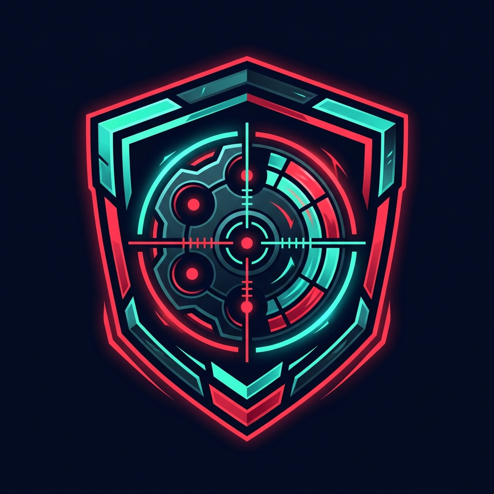
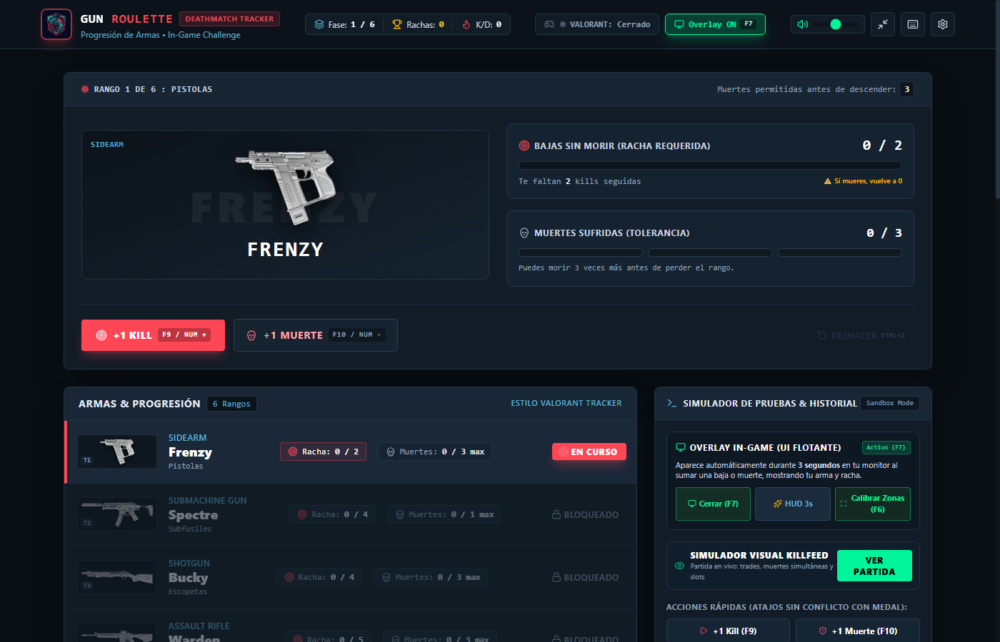
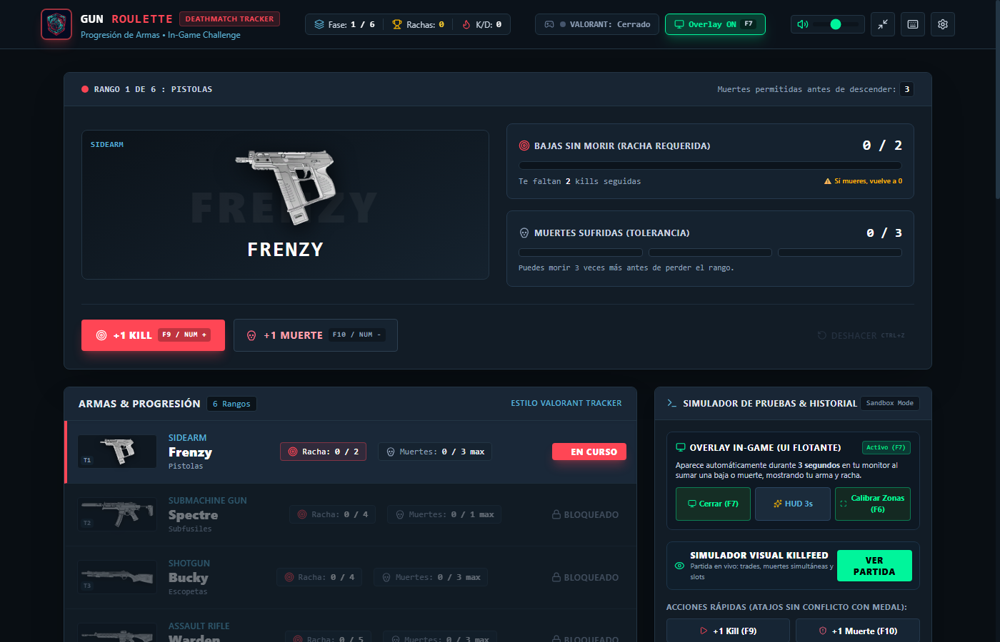
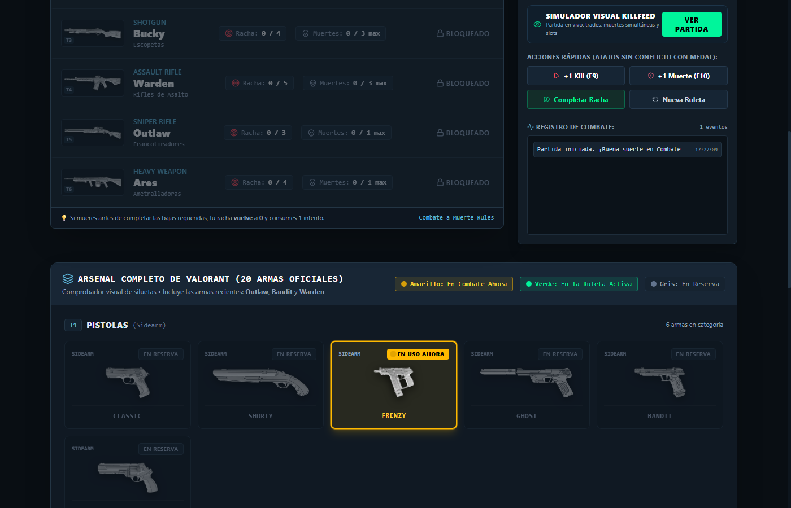

# VALORANT Gun Roulette Challenge 🎯🔫

<p align="center">
  
</p>

<p align="center">
  <a href="https://dev.overwolf.com/"></a>
  <a href="https://playvalorant.com/"></a>
  <a href="LICENSE"></a>
  
</p>

An interactive companion overlay and adaptive aim-challenge progression tool designed for **VALORANT Deathmatch** and casual practice sessions. 

The application introduces a dynamic weapon progression challenge (Gun Roulette): players are assigned randomized weapons within structured tiers and must achieve a set target kill count before rotating to the next weapon tier, all while managing limited lives.

---

## 📸 Screenshots & Showcase

### 1. Main Dashboard & Active Challenge Progression
The central control center displays the current active weapon, target kills needed, killstreak count, and remaining lives. Real-time controls and sandboxed combat simulations allow testing and validation under all conditions.

<p align="center">
  
</p>

---

### 2. In-Game Tactical Toast HUD
A lightweight, transparent in-game overlay that flashes clean toast notifications when a kill is registered, when a killstreak is achieved, or when a weapon switch occurs—ensuring zero distraction during intense gunfights.

<p align="center">
  
</p>

---

### 3. Full Arsenal Progression & Weapon Board
Track every weapon across all categories—Sidearms, SMGs, Shotguns, Rifles, Snipers, and Machine Guns—mirroring the official VALORANT buy menu layout with clean status indicators.

<p align="center">
  
</p>

---

## 🌟 Key Features

- **Dynamic Weapon Tier Progression:** Progress through distinct weapon categories (Sidearms, SMGs, Shotguns, Rifles, Machine Guns, and Snipers).
- **Adaptive Aim Handicap:** Players are assigned a randomized weapon and a target number of kills required to advance to the next tier.
- **Life & Penalty System:** 3 lives per tier. Dying depletes a life; losing all lives on a tier forces an alternate weapon rotation within the same category.
- **Overwolf Integration:** Seamlessly synchronizes with the Overwolf Game Events Provider for real-time, low-latency in-game event detection.
- **Passive Vision Fallback:** Integrated lightweight WinRT OCR detector to read killfeed notifications locally without inspecting game memory or injecting code.
- **Customizable In-Game HUD:** Non-intrusive, clean tactical overlay with transparency toggle and quick calibration hotkeys (`F6` calibration, `F7` overlay toggle, `F9` manual kill, `F10` manual death, `F11` respawn cooldown).

---

## 🛡️ Fair Play & Policy Compliance

This application is strictly designed within the guidelines of **Riot Games' Policies** and **Overwolf Game Compliance**:

1. **No Competitive Advantage:** The app only applies restrictions and handicaps to the user. It does not provide radar, wallhacks, auto-aim, recoil compensation, or any tactical assistance.
2. **No Memory Tampering:** Does not read or write to VALORANT's game memory, inject DLLs, or modify game files.
3. **No Toxic Shaming:** Does not evaluate, score, or track other players in the match. Only the local player's personal challenge score is displayed.
4. **Free & Community-Driven:** 100% free to use with no locked features, paywalls, or Elo/MMR calculations.

---

## 🛠️ Tech Stack

- **Frontend:** React 18 / 19, Vite, Tailwind CSS, Lucide React
- **Platform:** Overwolf SDK & Game Events Provider (GEP)
- **Desktop Runtime:** Electron / Native Windows Shell
- **Detector Engine:** Python 3.11 + WinRT OCR (Windows.Media.Ocr)

---

## 🚀 Getting Started

### Prerequisites
- Node.js (v18 or newer)
- Overwolf Client (Developer Mode enabled) or Python 3.10+ (for local desktop standalone mode)

### Installation

1. Clone this repository:
   ```bash
   git clone https://github.com/aacalde666/valorant-gun-roulette.git
   cd valorant-gun-roulette
   ```

2. Install dependencies:
   ```bash
   npm install
   ```

3. Start development server:
   ```bash
   npm run dev
   ```

4. Build Overwolf package (`.opk`):
   ```bash
   npm run build
   python pack_opk.py
   ```

---

## ⚖️ Legal Disclaimer

*Valorant Gun Roulette Challenge isn't endorsed by Riot Games and doesn't reflect the views or opinions of Riot Games or anyone officially involved in producing or managing Riot Games properties. Riot Games, and all associated properties are trademarks or registered trademarks of Riot Games, Inc.*
